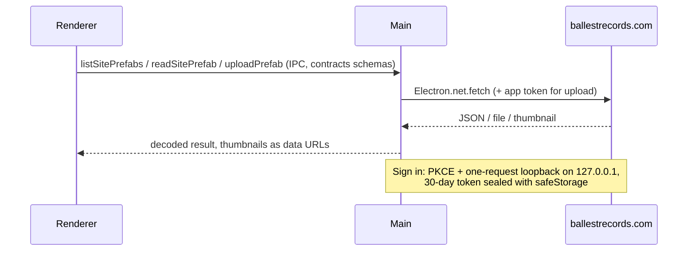
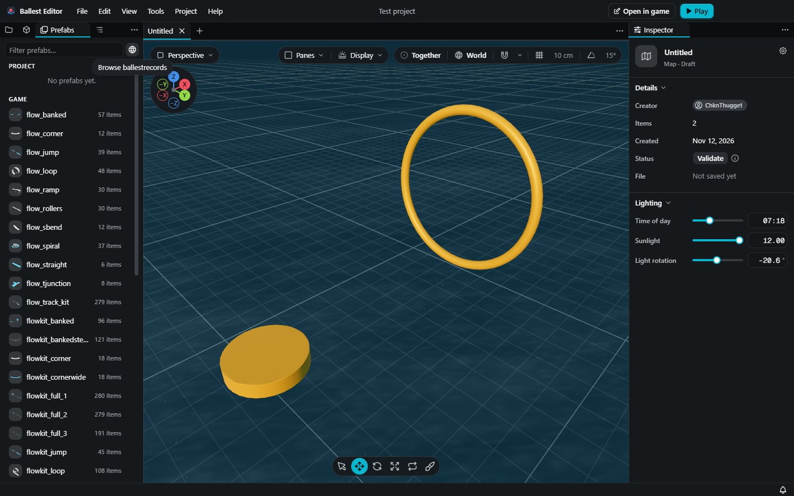
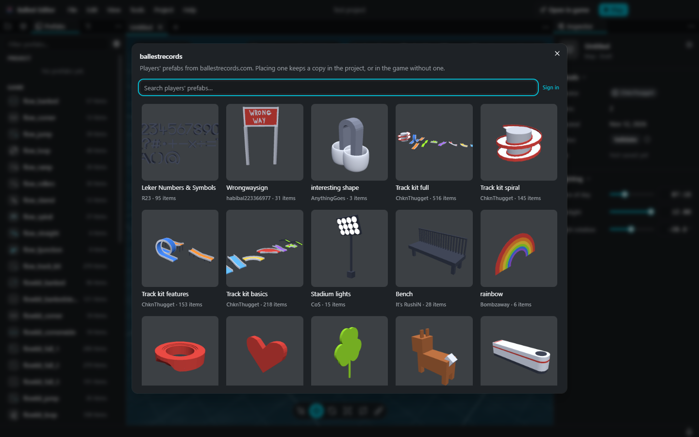
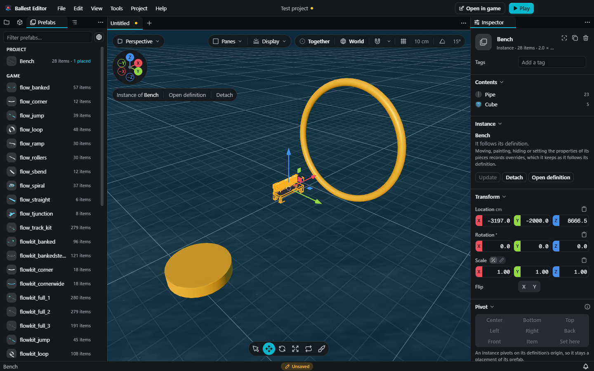
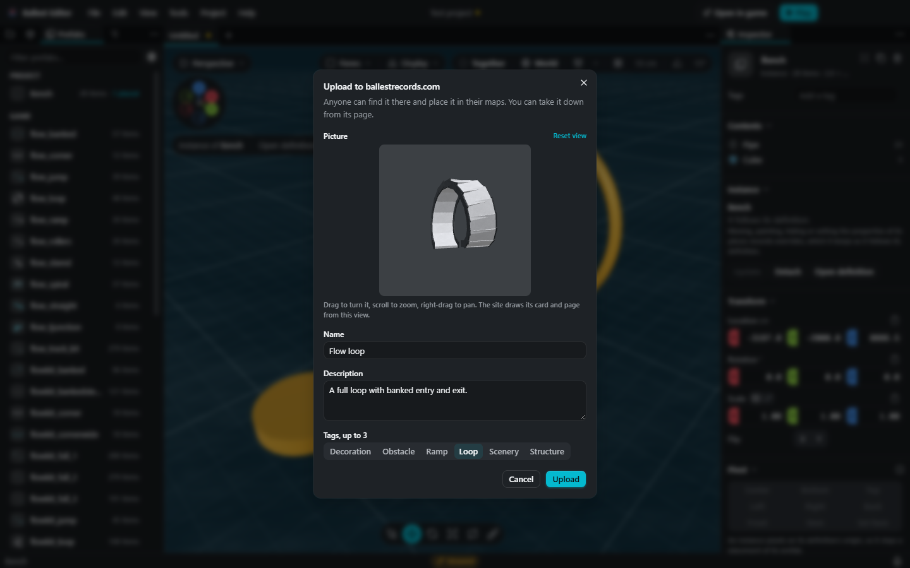

## Summary

Puts [ballestrecords.com](https://ballestrecords.com)'s player prefab gallery inside the Prefabs panel on the desktop: browse it, place from it, and upload your own prefab to it.

```diff
 <PrefabsPanel>
-  <Input filter />
+  <Input filter />  <Button globe "Browse ballestrecords"> → openDialog("siteGallery")
   <PrefabRow menu>
+    Upload to ballestrecords.com…  → openDialog("uploadPrefab")
+<SiteGalleryDialog>            search, Sign in, cards (most favourited, 50 a page, More)
+  <SitePrefabCard> click       → placeSitePrefab: copy into Project (Game in Untitled), then place as an instance
+<UploadPrefabDialog>
+  <SiteAnglePicker>            drag / scroll / right-drag → the site's `angle` + a PNG
```

Every request goes through main, so the page's CSP (`connect-src 'self'`) is unchanged and the sign-in token never reaches the renderer:



```text
packages/contracts/src/site.ts        # schemas + 7 IPC methods
apps/desktop/src/site/                # SiteClient (requests), SiteAccount (sign-in, token)
apps/desktop/src/ipc/methods/site.ts  # handlers
apps/web/src/editor/actions/site.ts   # place, copy, sign in, upload
apps/web/src/editor/siteAngle.ts      # camera <-> the site's angle
apps/web/src/editor/sitePreview.ts    # the upload's 3D preview
apps/web/src/components/SitePrefabs.tsx, SiteAnglePicker.tsx, PrefabDialogs.tsx
```

The web review build has no gallery (`capabilities.site` is false). `BALLEST_RECORDS_URL` points main at another copy of the site. The globe placement was picked in a live design round in the dev app.

## Evidence

- **Before:** the Prefabs panel has only the Game and Project tiers; prefabs on ballestrecords.com have to be downloaded by hand into the game's prefabs folder.
  **After** (desktop dev app on Windows, against the live site):

  The globe button beside the filter:
  

  The gallery window:
  

  A gallery prefab placed: copied into Project and placed as an instance:
  

  Upload, with the picture's view turned (not sent):
  

- **Tests**, all new, all passing:

  ```text
  apps/desktop  src/ipc/site.ipc.test.ts  (over IPC, against a fake site)
    ✓ lists a page of the gallery, most favourited first, with the search and the cursor
    ✓ reads a prefab's file and thumbnail, and refuses a slug that isn't one
    ✓ signs in through the browser with PKCE, keeps the token, and signs out   (real loopback socket)
    ✓ says when the player turned the sign-in down
    ✓ uploads a tier's prefab under the token, and tells each refusal apart  (angle + PNG sent; 429, 400, 401)
  apps/web  src/editor/actions/site.test.ts, src/editor/siteAngle.test.ts
    ✓ place a site prefab as an instance of a copy in the project, kept once however often it is placed
    ✓ take a site prefab under a free name when the tier has another of its name
    ✓ sign in and out, and keep what main says in the store
    ✓ upload a tier's prefab, link the notification to its page, and say why the site refused one
    ✓ reads back the angle a camera was framed with
    ✓ frames the default view three-quarters from above, at the distance that just fits
    ✓ clamps a view past the site's limits to the nearest it takes
  Tests  12 passed (12)
  ```

## Merge Danger

**Door:** two-way

Nothing is migrated or rewritten: the only new file on disk is `<userData>/site-account.json` (the sealed token), and a revert removes the feature. A placed site prefab is an ordinary prefab file in the tier.

**Blast Radius:** the Prefabs panel

Uploads post to the live site under the player's Steam account, so a bug there is visible on ballestrecords.com (the site moderates new uploads and limits them to 5 an hour). The upload path has only run against the fake site; no real upload was sent in testing.

## Checked

- Plan, design, spec and tickets: no spec issue; the entry point (globe button, gallery window) and the upload's picture view were settled in a live design round in the dev app.
- Tests written first: the IPC and action tests were written alongside the code, not strictly first.
- `/code-review`: not run.
- `/codebase-design`: not run.
- In the app: browsing, placing and the upload dialog in the desktop dev app on Windows against the live site; no upload sent. `pnpm check:changed` passes (lint, knip, dupes, typecheck, tests); dprint couldn't download its plugins in the cloud, so the same plugin versions from npm were run on the changed files, clean.
- `main` merged: branch is on `main` as of v0.3.2; CI runs `pnpm check:everything`.
